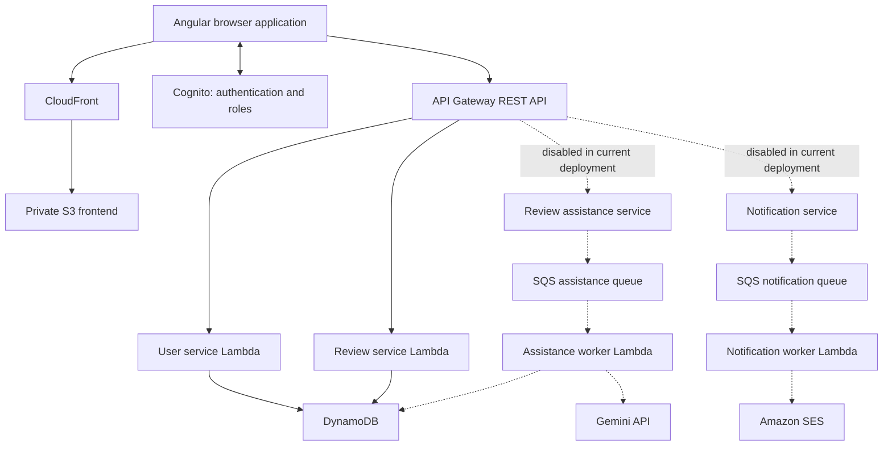
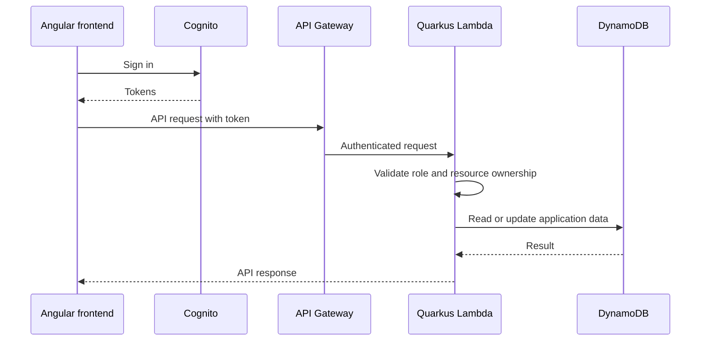
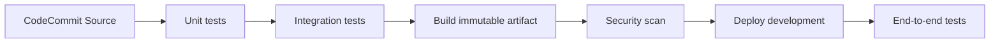

# CatalystFlow

Author: Nixon

A performance review platform with employee, manager and administrator workflows, an Angular frontend, and Java 21/Quarkus services on AWS. This repository collects the frontend and backend source under one project; each component retains its existing buildspecs and infrastructure definitions.

## System design



### Authenticated request flow



## Repository layout

| Path | Purpose |
|---|---|
| `frontend/` | Angular 18 application, UI tests and frontend delivery |
| `backend/user-service/` | User profiles and authentication-related application logic |
| `backend/review-service/` | Review workflows |
| `backend/ai-service/`, `backend/ai-worker/` | Optional review assistance and background processing |
| `backend/notification-service/`, `backend/notification-worker/` | Optional notification processing |
| `backend/template.yaml` | SAM application infrastructure |
| `backend/infra/` | Hosting and delivery infrastructure |
| `backend/scripts/` | Delivery validation and synthetic organisation fixtures |

## Delivery design



Each component defines Source, UnitTests, IntegrationTests, Build, SecurityScan, Deploy and E2E stages. Deploy checks artifact checksums and releases the same artifact that passed the scan. The security gate blocks configured CRITICAL findings; it does not establish that all lower-severity findings are resolved. E2E runs after development deployment, so an E2E failure marks delivery failed without automatically rolling back application data.

The original AWS pipelines use separate CodeCommit repositories and component-root buildspec paths. This combined GitHub repository is a source mirror: pushing here does not trigger or reconfigure those pipelines. To build from GitHub, configure an AWS CodeConnections source and adjust component working directories, buildspec paths and artifact paths, or retain the separate component repositories as delivery sources. No automatic deployment workflow is installed here.

Frontend deployment generates API/Cognito configuration from environment-scoped AWS settings; browser code must not contain AWS access keys or a Cognito client secret. Backend delivery currently packages JVM Lambda artifacts using `java21`; the optional native profile is separate.

## Local development

Prerequisites: Java 21, Maven, Node.js/npm compatible with the frontend lockfile, and an AWS development environment for cloud-dependent checks.

Backend:

```powershell
cd backend
mvn test -Dquarkus.dynamodb.devservices.enabled=false -Dquarkus.sqs.devservices.enabled=false -Djacoco.skip=true
python scripts/validate-delivery.py
```

The delivery validator requires PyYAML. Review `template-local.yaml` and service configuration before local emulation. The root backend POM builds the service modules; deployed E2E checks live in the separate `e2e-tests` module and require configured cloud fixtures.

Frontend:

```powershell
cd frontend
npm ci
npm run start:proxy
```

The proxy expects an API on localhost:3000. Use `npm run test:ci` for the browser unit suite; Chrome is required. See component READMEs and buildspec files for integration and deployed E2E commands.

## Roles, data and configuration

Employees, managers and administrators have distinct workflows. Backend authorization must enforce roles and ownership independently of frontend navigation. DynamoDB stores application profiles, review and configuration records; Cognito supplies identity. Synthetic organisation scripts create demonstration employees across disciplines, seniority levels and reporting relationships. Shared demo credentials in the UI are for a synthetic sandbox only.

Review assistance and email are disabled in the current development deployment. Their services remain in source, with workers and queue mappings disabled through deployment configuration. Enabling them requires deliberate configuration, model credentials and SES setup. Do not treat their presence in the diagram as evidence they are currently active.

Local secrets, generated build output and Git history from the original repositories are excluded. Existing third-party notices are retained. Original AWS account identifiers remain in deployment definitions: configure and review these for your own account before deploying.

## Source scope

This snapshot includes the available Angular and Quarkus applications. An MCP server/adapter is not present in these component sources, so this README does not claim an implemented MCP integration.
